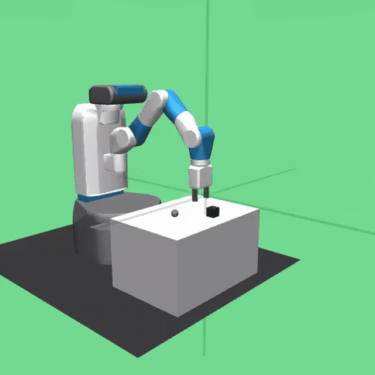

# Robot arm · SAC + HER

Learning to pick up a block and place it at a target using **Soft Actor-Critic** and **Hindsight Experience Replay**. A goal-conditioned policy learns continuous gripper and end-effector control in Gymnasium Robotics’ Fetch environment.

**Python · Stable-Baselines3 · Gymnasium Robotics · MuJoCo**



[Full demonstration ↗](https://aravsportfolio.com/?project=robot-arm-pick-and-place) · [Source](SAC_HER_RobotArm.py)

## Approach

Fetch exposes the current observation, the achieved goal, and the desired goal. HER relabels unsuccessful experience with goals the agent actually reached, creating useful learning signals from sparse rewards.

| Training configuration | Default |
| :--- | :--- |
| Environment | `FetchPickAndPlace-v4`, with a `v3` fallback |
| Policy | `MultiInputPolicy` |
| Training | 2,000,000 timesteps across 4 environments |
| Replay buffer | 1,000,000 transitions |
| HER | 4 sampled goals, `future` strategy |
| Discount / batch size | 0.98 / 256 |
| Recorded episode cap | 50 steps |

## Run

Use a Python environment compatible with Gymnasium Robotics and Stable-Baselines3. Install the dependencies, then run from this repository:

```bash
python -m pip install gymnasium gymnasium-robotics stable-baselines3 mujoco imageio imageio-ffmpeg
python SAC_HER_RobotArm.py
```

The script records **pre-training, midpoint, and final** rollouts to `pickplace/videos/` and saves the final model to `pickplace/models/`. Each checkpoint records 20 episodes. Rendering requires a working MuJoCo graphics backend.

## Evidence and scope

The GIF is a short extract from the recorded portfolio demonstration. The repository contains the training and recording script; trained weights and raw evaluation logs are not checked in. The script does not calculate a success-rate benchmark, so the demonstration should be read as a rollout rather than a measured generalization result.
